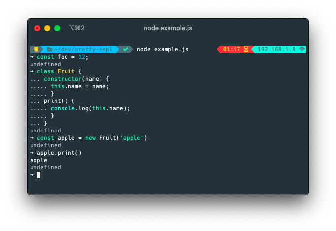

# Pretty REPL

[](https://github.com/mongodb-js/pretty-repl/actions/workflows/check-test.yaml)

An extension of the Node REPL (`repl.REPLServer`) that applies syntax highlighting as the user types.



## How to use it

Install the package:

```bash
$ npm install --save pretty-repl
```

Use the package:

```javascript
const repl = require('pretty-repl');

const options = {
    prompt: '→ '
};

repl.start(options);
```

`options` is an an object with the [same options](https://nodejs.org/api/repl.html#repl_repl_start_options) as `repl.REPLServer`.

Additionally, it's possible to pass an additional `colorize` property to the options object:

```javascript
{
    colorize: function (str) {
        // str is the the string in input.
        // the function should return the string that has been colorized to output in the REPL.
    }
}
```

In order to highlighting matching pairs of brackets, a `colorizeMatchingBracket`
is also available.

## Releasing

Releases are automated. Three workflows hand off to each other, each triggered by the previous one
finishing:

| Workflow | File | Trigger | What it does |
| --- | --- | --- | --- |
| **Check and Test** | `.github/workflows/check-test.yaml` | every PR, and every push to `main` | Runs `npm run check` and `npm test` on the supported Node versions. |
| **Bump packages** | `.github/workflows/bump-packages.yaml` | *Check and Test* completing on `main` | Works out the next version from the commit messages, writes it to `package.json`, and pushes a `chore(ci): bump packages` commit to `main`. |
| **Release** | `.github/workflows/release.yaml` | *Check and Test* completing on `main` | Only acts on the bump commit: publishes to npm and pushes the `vX.Y.Z` tag. |

The change flows like this:

```
merge PR to main
  → Check and Test          (does it pass?)
  → Bump packages           pushes "chore(ci): bump packages" to main
  → Check and Test          (runs again, on the bump commit)
  → Release                 npm publish + git tag vX.Y.Z
```

### How the version number is chosen

`npm run bump-packages` (`bump-monorepo-packages`, from
[`@mongodb-js/monorepo-tools`](https://github.com/mongodb-js/devtools-shared))
reads the [conventional commit](https://www.conventionalcommits.org/) messages
merged since the last bump commit and takes the largest bump any of them asks
for:

| Commit subject | Bump |
| --- | --- |
| `feat: …`, `feat(scope): …` | minor |
| `feat!: …`, `fix(scope)!: …`, or `BREAKING CHANGE` in the subject or body | major |
| anything else: `fix:`, `chore:`, `docs:`, `ci:`, … | patch |

Note that patch is the *default*, not a "no release" case: any commit that isn't
`feat` or breaking still produces a patch release.

### Triggering a release manually

Both workflows also accept `workflow_dispatch`, so you can run *Bump packages*
or *Release* from the Actions tab if the chain needs a nudge. *Release* run this
way skips the commit-message guard and publishes whatever version is currently
in `package.json`.

## Credits

Pretty repl is inspired and includes code fragments from:
* https://github.com/nodejs/repl
* https://github.com/aantthony/node-color-readline
